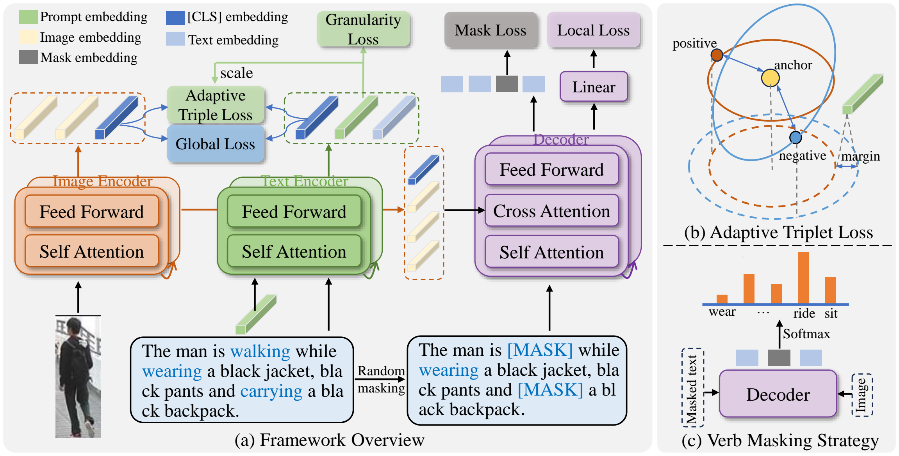

<div align="center">

# MG-REID

### Multi-Granularity Text-to-Image Re-Identification with Action-Oriented Verb Masking


**[Luperson-MG on Hugging Face](https://huggingface.co/datasets/Graysonicc/Luperson-MG-1M)**

</div>

---

## Highlights

- **Multi-granularity person retrieval.** Extend text-to-image person ReID beyond detailed descriptions to support short descriptions, with multi-granularity annotations generated using multi-modal large language models (MLLMs).
- **Granularity-adaptive alignment.** Use a prompt-based adaptive triplet loss to align image and text features according to description granularity during both pre-training and fine-tuning.
- **Action-aware representation learning.** Introduce action-oriented verb masking to capture action cues alongside appearance information.

## Abstract

Text-to-image person re-identification (ReID) aims to retrieve the related person according to the given textual description. Despite the performance improvement on such a task, existing methods mainly concentrate on searching people from detailed descriptions, which are sometimes inaccessible in real applications. To address this issue, in this paper, we introduce a new task called multi-granularity text-to-image person ReID which aims at retrieving people from multi-granularity (detailed or short) textual descriptions.

Specifically, we first annotate multi-granularity descriptions using multi-modal large language models (MLLMs) and process the textual descriptions of existing benchmarks into multiple granularities. To enable the model to learn from multi-grained descriptions, we introduce a prompt-based adaptive triplet loss to adaptively align the image and text features based on the granularity of description in both pre-training and fine-tuning phases. Furthermore, to make the model pay attention to action descriptions as well as appearance descriptions, an action-oriented verb masking strategy is proposed to make the model take notice of action-related verbs.

Extensive experiments are conducted on multiple benchmarks (i.e., CUHK-PEDES, ICFG-PEDES, and RSTPReID) across different granularities (detailed, short). Results show that our method achieves state-of-the-art performance in fine-grained retrieval and substantially outperforms existing methods in coarse-grained retrieval.

## Framework

<p align="center">
  <a href="doc/framework_new.pdf">
    
  </a>
</p>

<p align="center">
  <em>(a) Framework overview. (b) Adaptive triplet loss. (c) Verb masking strategy.</em><br>
</p>

## Dataset

### Luperson-MG-1M

The **Luperson-MG-1M** dataset is available on Hugging Face:

**[Luperson-MG-1M](https://huggingface.co/datasets/Graysonicc/Luperson-MG-1M)**

Visit the dataset page for the released files and accompanying dataset information.

### Evaluation benchmarks

The paper evaluates retrieval on **CUHK-PEDES**, **ICFG-PEDES**, and **RSTPReID**, using both **detailed** and **short** descriptions.

| Benchmark | Configuration | Default image directory | Annotation filename |
| :--- | :--- | :--- | :--- |
| CUHK-PEDES | [retrieval_cuhk.yaml](configs/retrieval_cuhk.yaml) | `datasets/CUHK-PEDES/imgs` | `reid_raw.json` |
| ICFG-PEDES | [retrieval_icfg.yaml](configs/retrieval_icfg.yaml) | `datasets/ICFG-PEDES/imgs` | `ICFG-PEDES.json` |
| RSTPReID | [retrieval_rstp.yaml](configs/retrieval_rstp.yaml) | `datasets/RSTPReid/imgs` | `data_captions.json` |

> **Data paths:** Set `image_root` in the corresponding YAML configuration. Annotation paths are currently hard-coded under `/datasets/` in `data/cuhk_dataset.py`, `data/icfg_dataset.py`, and `data/rstp_dataset.py`; update them to match your local annotation files. Changing `ann_root` alone does not redirect these loaders.

## Getting Started

### 1. Environment

Use a Python environment with CUDA-enabled [PyTorch and torchvision](https://pytorch.org/get-started/locally/). The current distributed implementation uses NCCL. Run all commands below from the repository root.

Install the additional dependencies:

```bash
pip install -r requirements.txt
```

Also prepare:

- The **`bert-base-uncased`** tokenizer used by `models/blip.py`, either through Hugging Face or a local model directory.
- The English POS-tagging resources required by `nltk.pos_tag`. See the [NLTK data documentation](https://www.nltk.org/data.html) for installation; the resource name depends on your NLTK version.

### 2. Datasets

Prepare the benchmark images and annotations, then update the paths described in [Dataset](#dataset). Use the appropriate multi-granularity descriptions for the intended experiment.

### 3. Model initialization

Download the pre-trained model from **[Luperson-MG-pretrained](https://huggingface.co/Graysonicc/Luperson-MG-pretrained)** on Hugging Face.

Save the downloaded checkpoint locally and set `pretrained` in the selected YAML configuration to its path. The current default is:

```text
checkpoint/pretrained_model.pth
```


## Training & Evaluation

### Fine-tuning

Example for CUHK-PEDES:

```bash
bash train.bash
```

### Evaluation

Evaluate a fine-tuned checkpoint with the matching benchmark configuration:

```bash
bash eval.bash
```

The evaluation code reports **Rank@1**, **Rank@5**, **Rank@10**, and **mAP**.


## Acknowledgments

This repository builds on [CADA](https://github.com/LinDixuan/CADA), [BLIP](https://github.com/salesforce/BLIP), and [NLTK](https://www.nltk.org/). We thank their authors and contributors for sharing code, models, and tools.
